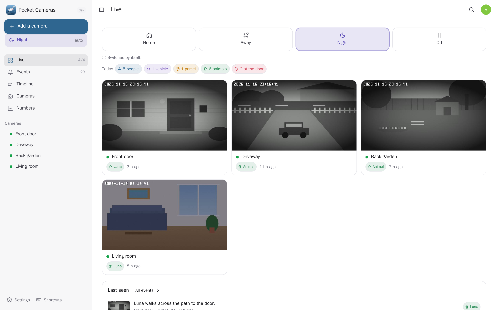
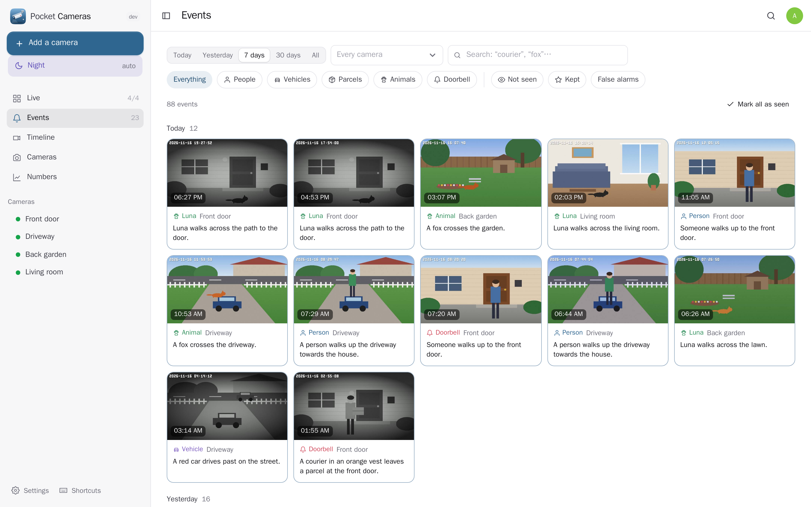
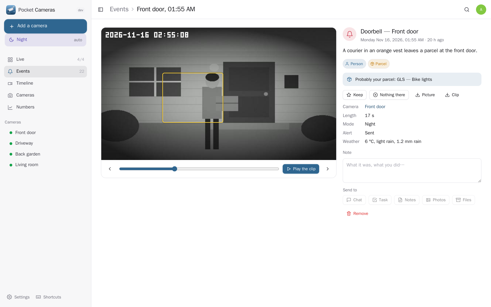
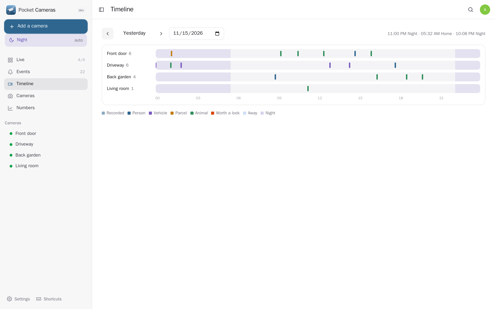
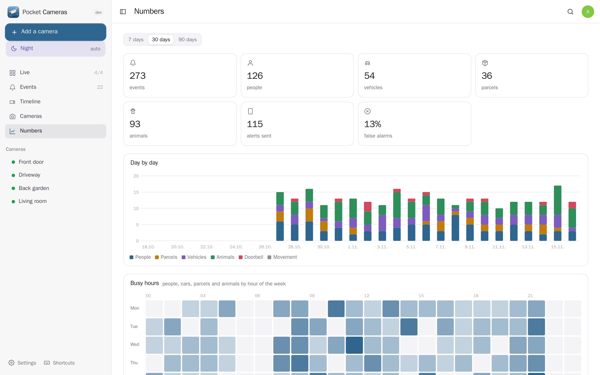
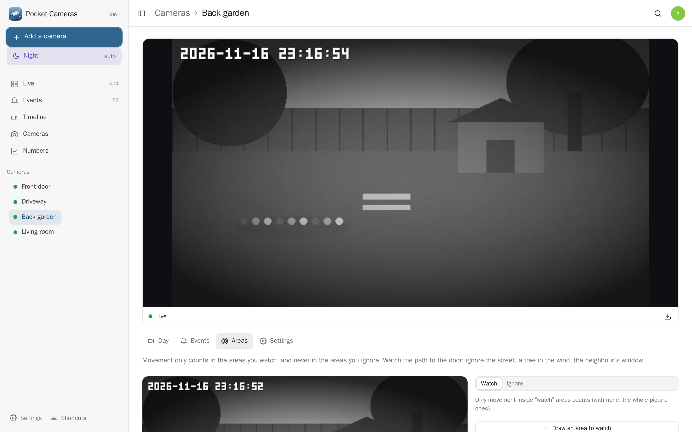
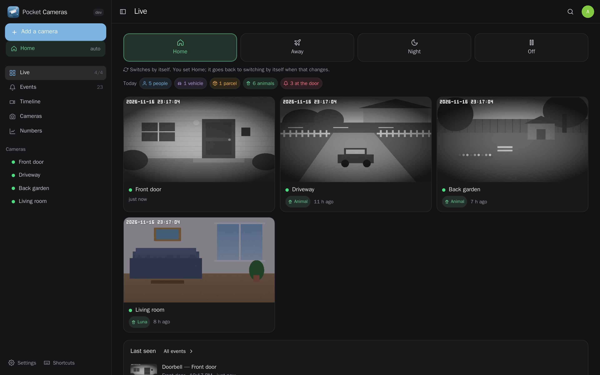
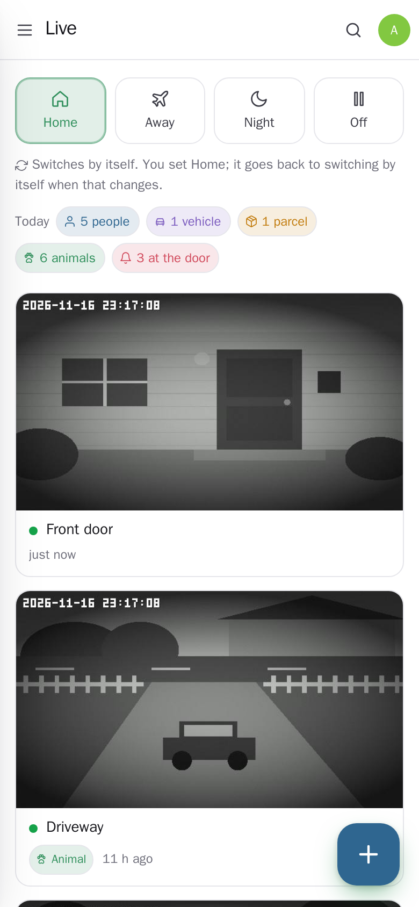
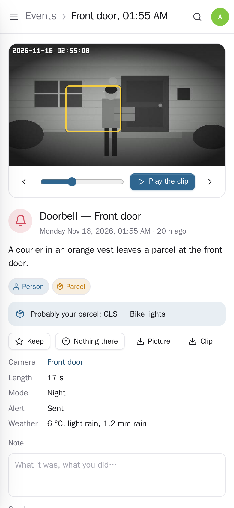
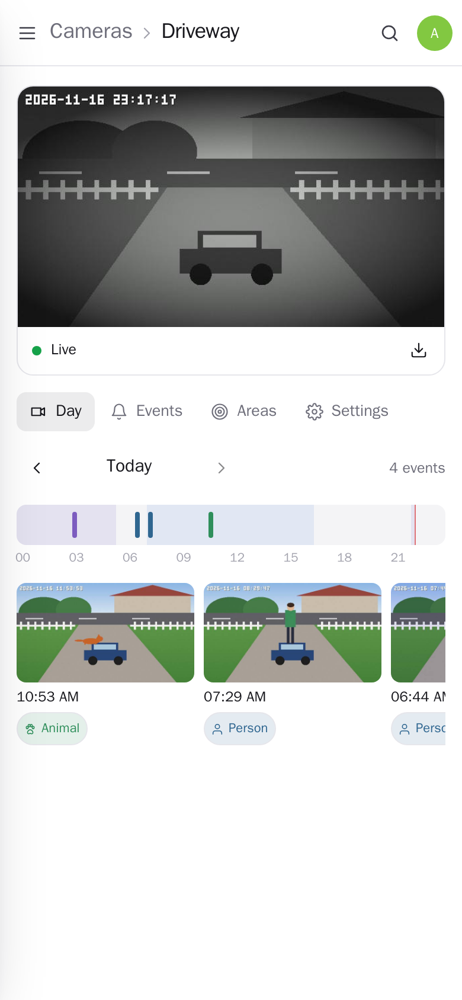

<p align="center"></p>
<h1 align="center">Pocket Cameras</h1>
<p align="center">Your security cameras on your own server: every camera live, movement checked in the parts of the picture you choose, each event looked at by AI (a person, a car, a parcel, an animal — or nothing), recordings on a day timeline, Home / Away / Night modes that switch by themselves, and an alert on your phone when it matters. A Frigate replacement.<br>One Go binary, one SQLite file, one volume. Part of the Pocket apps; works on its own too.</p>
<p align="center">
  <a href="https://github.com/abjelosevic88/pocket-homelab-cameras/actions"></a>
  <a href="https://github.com/abjelosevic88/pocket-homelab-cameras/pkgs/container/pocket-homelab-cameras"></a>
  <a href="LICENSE"></a>
</p>

---

<p align="center"></p>

<table>
  <tr>
    <td width="50%"></td>
    <td width="50%"></td>
  </tr>
  <tr>
    <td align="center"><sub>Events: what each camera saw, in the AI's words, by day.</sub></td>
    <td align="center"><sub>An event: its pictures and clip, which parcel it probably was, keep it, send it on.</sub></td>
  </tr>
  <tr>
    <td width="50%"></td>
    <td width="50%"></td>
  </tr>
  <tr>
    <td align="center"><sub>Timeline: a day of every camera — recordings, events, the mode — and the video.</sub></td>
    <td align="center"><sub>Numbers: people, cars, parcels and animals by day, the busy hours, storage.</sub></td>
  </tr>
  <tr>
    <td width="50%"></td>
    <td width="50%"></td>
  </tr>
  <tr>
    <td align="center"><sub>Areas: draw what to watch and what to ignore (the street, a tree).</sub></td>
    <td align="center"><sub>Light and dark, following your device.</sub></td>
  </tr>
</table>

<p align="center">
  &nbsp;&nbsp;
  &nbsp;&nbsp;
  
</p>

## What it does

**Cameras**
- Add a camera by its **make** and its address on your network — Reolink, Hikvision/Annke, Dahua/Amcrest/Lorex, TP-Link Tapo, UniFi Protect, Axis, Uniview, Foscam, eufy, Wyze, Imou — and it knows where the video is. Or paste any **RTSP** address, an **MJPEG** stream or a **snapshot** address. **Try it** shows the picture, the resolution and the codec before you save.
- **Find cameras** on your network: the ones Pocket Network knows, or a scan of an address range.
- **Bring them over from Frigate**: its `config.yml` with the streams (go2rtc restreams followed back to the camera), recording, zones, motion masks and tracked objects.
- **Live**: every camera in a grid that never flickers, one camera big with **HD** (the full stream), a picture to save.
- **Share** a camera with others on the box (they watch and get its alerts; they cannot change it). A **secret address** for Home Assistant, a wall tablet or Homepage.

**Events**
- Movement is checked a few times a second in the **areas you draw** (watch the path; ignore the street, the tree, the neighbour's window), with a sensitivity from “big things” to “small things”. Light switches and night vision do not count.
- Each event keeps its pictures (and a clip from the recordings) and its clearest picture goes to **Pocket AI** (or your own OpenAI key): *person, vehicle, animal, parcel or nothing*, one sentence (“A courier leaves a parcel at the front door.”) and whether it is worth a look. Nothing there? No alert.
- The AI knows **your pets** (Pocket Pets) so the cat does not wake you, the **parcel due today** (Pocket Parcels: “probably your DHL parcel — headphones”), and the **weather** (Pocket Weather: storms do not alert on their own).
- **Keep** an event (it stays, with its clip), mark it **nothing there**, a note, and **send it on**: to Pocket Chat, Tasks, Notes (for the insurance), Photos (the fox) or Files.
- **Doorbell and alarm buttons**: `POST /cameras/ID/ring` from Home Assistant, a Shelly button or a Shortcut keeps the picture and tells you — in every mode.

**Home, Away, Night, Off**
- Each camera alerts on what you choose (people, vehicles, parcels, animals) in the modes you choose (the garden at night and when away, the living room only when away). **Off** pauses alerts, not recording.
- **Switches by itself**: Night by the clock, **Away** during a trip in Pocket Travel, when you leave home (Pocket Movement) or when nobody's phone is on the home Wi-Fi (Pocket Network) — and back. A mode set by hand stays until that changes.

**Recordings**
- The full-quality stream is copied (not re-encoded) into one-minute files: **around events** (the rest goes after ten minutes) or **all the time**, kept for as many days as you say, with a cap for all of them (`RECORDINGS_MAX_GB`) — on a NAS too (`RECORDINGS_DIR`).
- A **day timeline** per camera and for all of them: tap to play from any moment; the video goes on piece after piece.

**Alerts** go through Pocket Alerts (and on to your phone), else Pocket Hub on your phone through Pocket Core, and/or your own Apprise / ntfy / webhook address. One per camera every few minutes; urgent ones always.

## Works with the other Pocket apps

All optional, each switched on per person (Pocket Core → Links, or directly with a URL and token):

| App | What for |
|---|---|
| Pocket Alerts | Someone at the door, a parcel, a car, a camera offline — on your phone |
| Pocket Network | Find the cameras on your network; Away when nobody's phone is home |
| Pocket Movement | Away when you leave home, Home when you are back |
| Pocket Travel | Away while a trip is on |
| Pocket Parcels | Which parcel a courier probably brought |
| Pocket Pets | Your own pets by name, and quiet about them |
| Pocket Weather | The weather on each event; storms do not alert alone |
| Pocket Chat | Share a picture or clip of an event |
| Pocket Tasks | A task from an event |
| Pocket Notes | An event written down with its picture |
| Pocket Photos | Keep a picture in your photo library |
| Pocket Files | Keep an event's clip and picture |
| Pocket Rooms | The room a camera is in, from your floor plans |
| Pocket Home | The camera as a thing in your home; a log note when it stays offline |

Cameras offers `cameras:read` and `cameras:write` to the rest of the box — Pocket Day writes visitors and deliveries into your journal, Pocket Search finds events (`!cameras parcel`), Pocket AI answers “who came today?” or switches the house to Away (`pocket_cameras_*` tools) — and publishes `cameras.person`, `vehicle`, `animal`, `parcel`, `doorbell`, `trigger`, `event`, `motion`, `offline`, `online`, `mode_changed` and `camera_added` for Pocket Flows.

It also tells Pocket Core what it can do, so Pocket Search, Pocket Day and Pocket Hub find it on their own, each through its own link:

| Link | What it gives |
|---|---|
| `pocket:search` | Your cameras and what they saw, by words (`!cameras parcel`, also `!cam` and `!cctv`) |
| `pocket:day` | What the cameras saw on one day and when the house went Home, Away, Night or Off |
| `pocket:widget` | The mode the house is in, cameras that are offline and the newest events you have not looked at |

These only read, and only from what Cameras already keeps: no camera is asked for a picture and no AI is called. Nothing can be added to Cameras from a quick line.

## Run it

```sh
docker run -d --name pocket-cameras -p 8080:8080 -v ./data:/data \
  -e BASE_URL=http://cameras.local:8080 -e ADMIN_EMAIL=you@example.com -e ADMIN_PASSWORD=change-me \
  ghcr.io/abjelosevic88/pocket-homelab-cameras:latest
```

Or [docker-compose.yml](docker-compose.yml), or a release binary (`pocket-cameras`, needs `ffmpeg` on the PATH for RTSP cameras and recording). `make run` starts it with four demo cameras that draw their own pictures and no login. The server has to reach your cameras on the network.

- [Configuration](docs/configuration.md) · [API](docs/api.md) · [Backup](docs/backup.md) · [Reverse proxy](docs/reverse-proxy.md)

## Develop

`make dev` (API on :8080, Vite on :5173), `make test` (go vet, go test, tsc). Go 1.26, React 19, TypeScript, Vite; SQLite through modernc (no CGO). Reading cameras, recording, the movement check (pure Go, on a small grid of the picture) and the demo drawings are in `internal/capture`; the running cameras in `internal/server/engine.go`. `scripts/screenshots.mjs` is a browser smoke test and makes the screenshots.

MIT © 2026 Aleksandar Bjelosevic
